# Features

takeover is a second-hand marketplace for students around EPFL, UNIL and the FMEL residences. It keeps listings, messages, deals and pickup in one app. Pako, a moving box, does the repetitive parts: he searches, drafts listings, researches prices, reads replies and prepares offers. He does not send, publish or agree to anything; each of those steps is a tap by the student.

The features below follow a student's path through the app. Screenshots are from the local demo with fictional students and listings; in the selling screenshots, the project's drawn illustrations stand in for item photos. The same steps as sequences are in [WORKFLOWS.md](WORKFLOWS.md).

Two modes exist. The **local demo** has no sign-in and keeps data in a SQLite file and the browser; the other students are fictional sellers. **Account mode** uses Supabase accounts for @epfl.ch and @unil.ch students. Differences are noted per feature.

## Design

The interface uses tactile cards and buttons with a pressed edge, calm motion that respects reduced-motion settings, and one illustration per demo listing. Pako appears once per moment, with a mood that fits it (thinking, celebrating, waiting).

## First visit

### Intro with Pako

A short intro for first-time visitors that explains the app with examples.

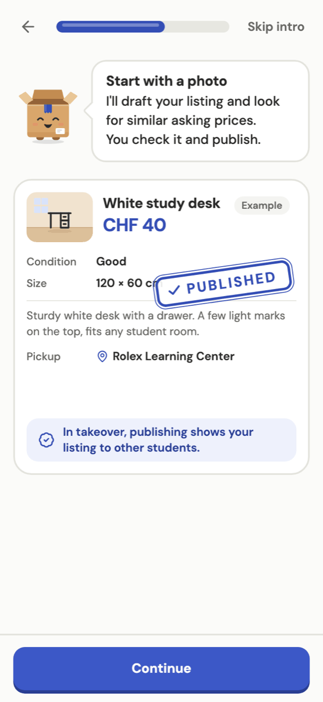

- Three questions (moving in or out, area, item) personalise three example scenes: a listing drafted from a photo, a deal both students confirm, and a search.
- It can be skipped at any step and reopened with How it works in the header.

### Home

The starting page for searching and selling.

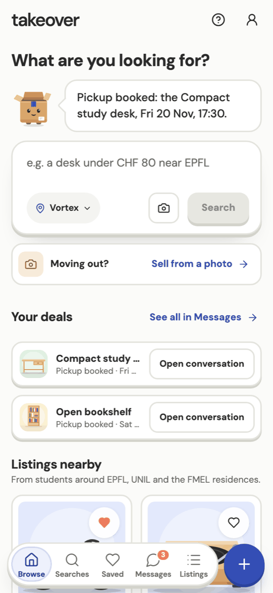

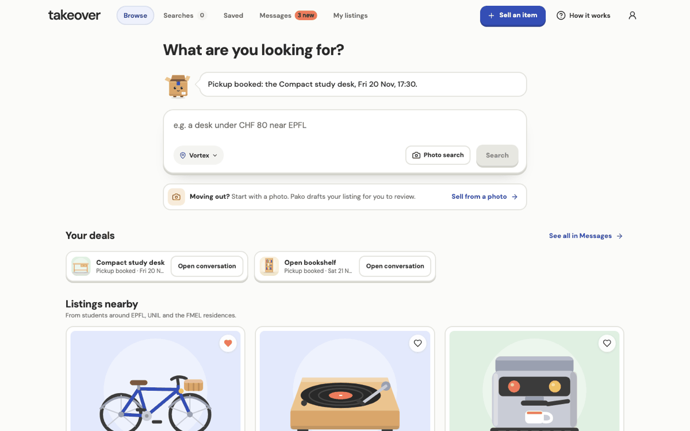

- A search field with an area chip and a photo search button, a Sell from a photo shortcut, and Listings nearby.
- Your deals lists booked pickups with a link to the conversation.

## Finding

### Search with Pako

A request in plain words returns student listings first and web results after them.

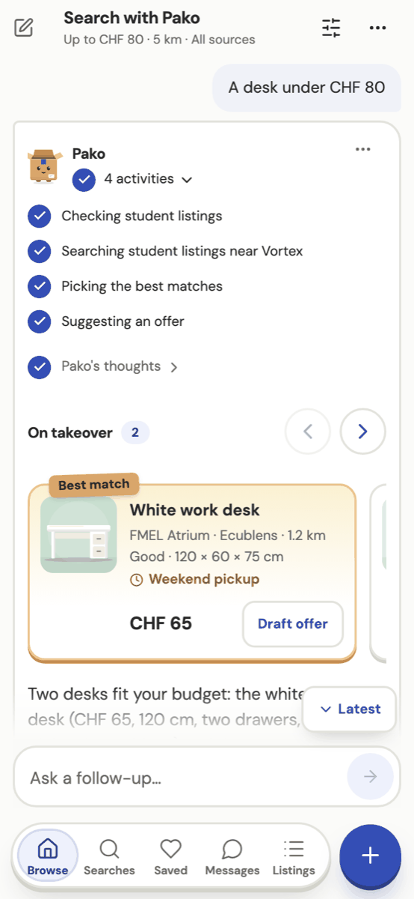

- Pako's activity lists each step he took. Results respect price, radius and condition filters, and a student's own listings are left out.
- Web results come from search snippets; prices and availability on other sites may be out of date.
- Quick replies under the answer offer next steps such as Draft offer, Compare two listings or a narrower filter.

### Compare listings

Two or three listings side by side.

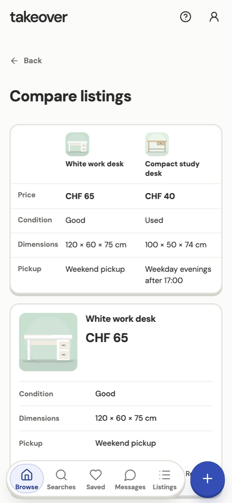

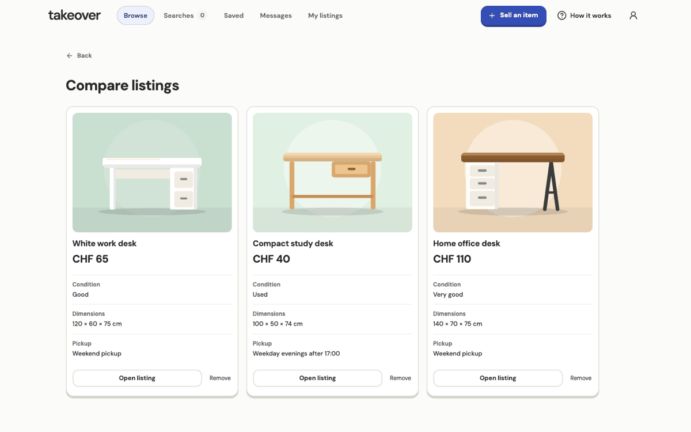

- Opened from the compare button on a card or from Pako's quick reply. Phones show the facts row by row; wider screens show columns.
- The selection is kept through a reload in the same tab.

### Saved searches

A search that keeps checking for new listings.

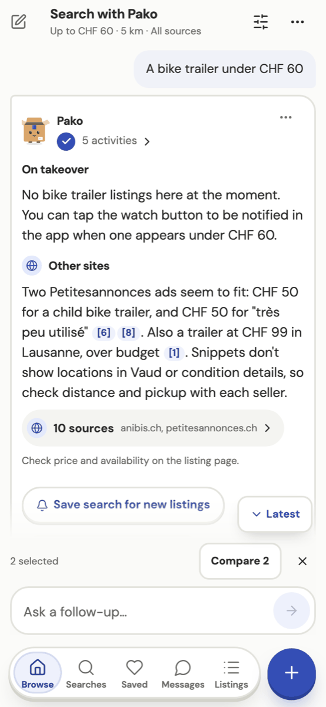

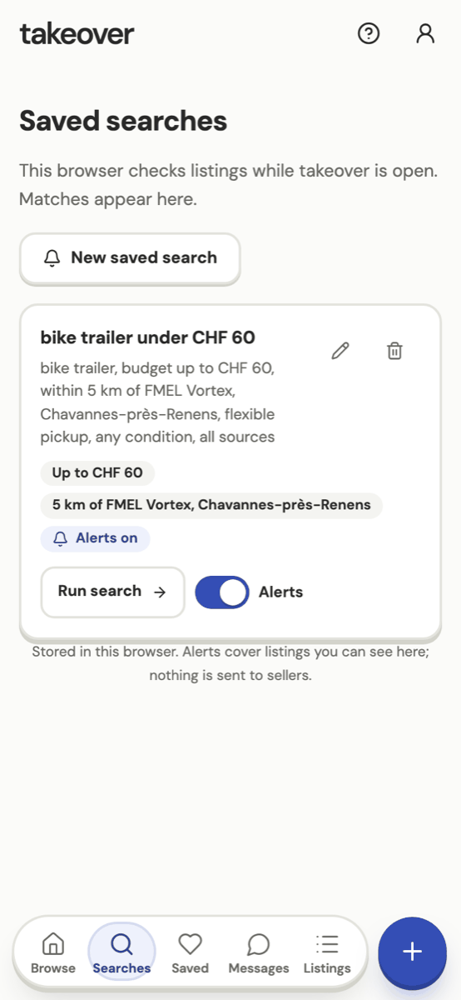

- When nothing fits, Pako offers Save search for new listings. The search is only saved on that tap.
- New matches appear on the Searches tab with an unread count. In the demo, saved searches live in the browser and are checked while the app is open.

## Offering and agreeing

### Listing page

The listing's facts and the way to make an offer.

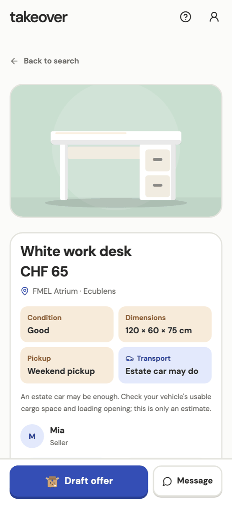

- Condition, dimensions, pickup times and a transport estimate (for example "Estate car may do").
- Draft offer with Pako opens the offer card; Message opens a plain conversation.

### Offer card

An offer that holds the price, pickup time and meeting point in one card.

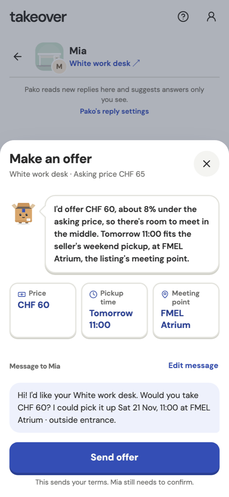

- Pako proposes a price and the earliest pickup time that fits the seller's pickup window, and explains why.
- Each value and the message can be edited. Nothing is sent until Send offer.

### Confirming a deal

Both students confirm the same terms before an item is reserved.

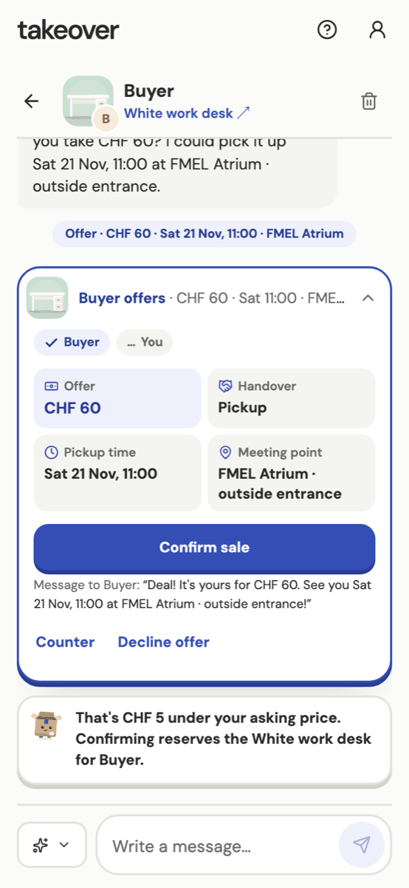

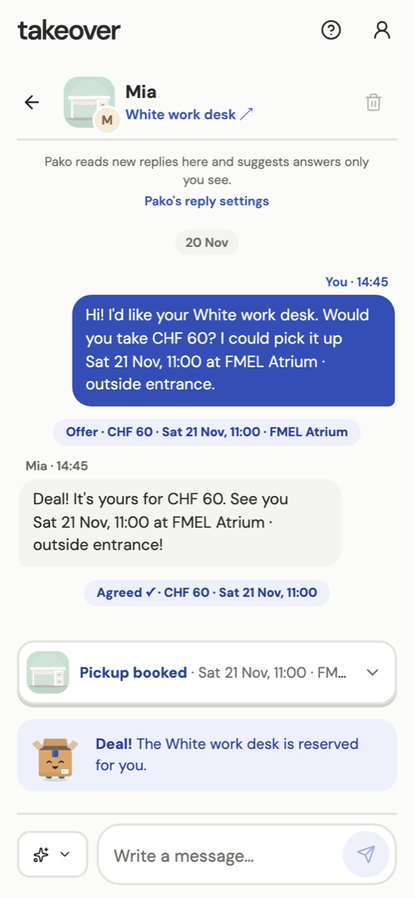

- The seller can Confirm sale, Counter or Decline offer. Confirming reserves the listing for this buyer.
- After that, the terms change only through the card's actions (Change time, Can't make it, cancel), not through chat text.

### Pako reads replies

Pako summarises the other student's reply and suggests answers that only the reader sees.

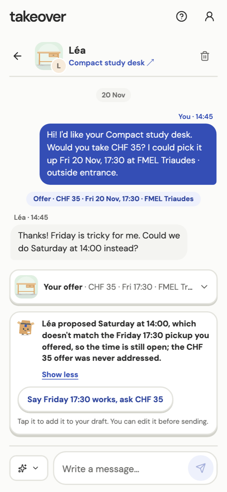

- With Read new replies automatically on (settings, on by default), Pako reads each new reply. A tapped suggestion goes into the draft and can be edited before sending.
- Email addresses and phone numbers are removed from messages before they reach the model. In account mode, auto-read stops when fewer than 6 readings are left for the day.

### Messages

All conversations with their deal state.

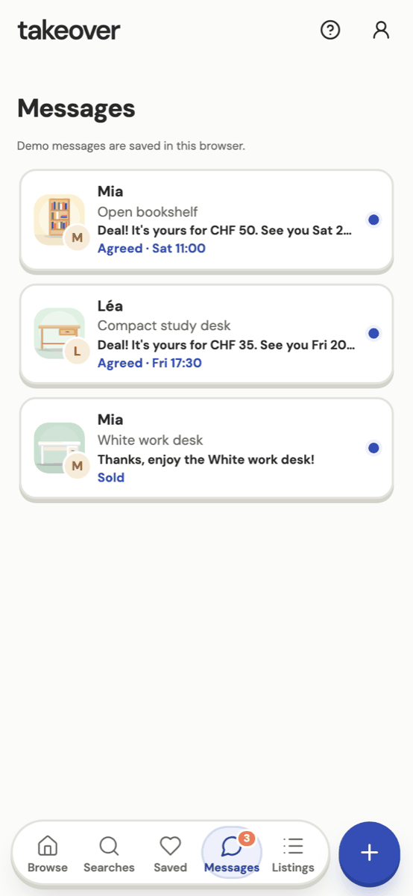

- Each conversation shows the latest message and its state (Agreed, Sold, Reservation released). A thread has its own address.
- Demo: conversations and deals are stored on the local server per browser. Account mode: real students, stored in Supabase.

## Pickup day

### Pickup card

The card shows what each student can do at the current moment of the pickup.

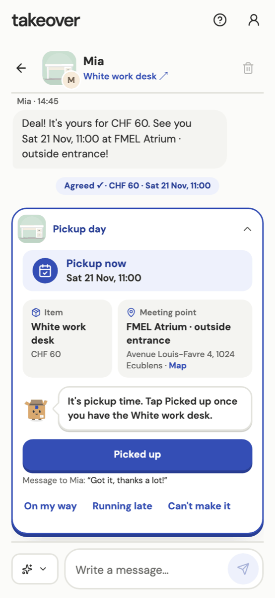

- A countdown, the meeting point with a map link, and the actions On my way, Running late (10, 20 or 30 minutes), Change time and Can't make it.
- At pickup time the buyer taps Picked up; the seller then taps Mark sold. A picked-up item stays reserved until the seller closes it.

### Pickup follow-up

A question for deals where nobody confirmed the pickup.

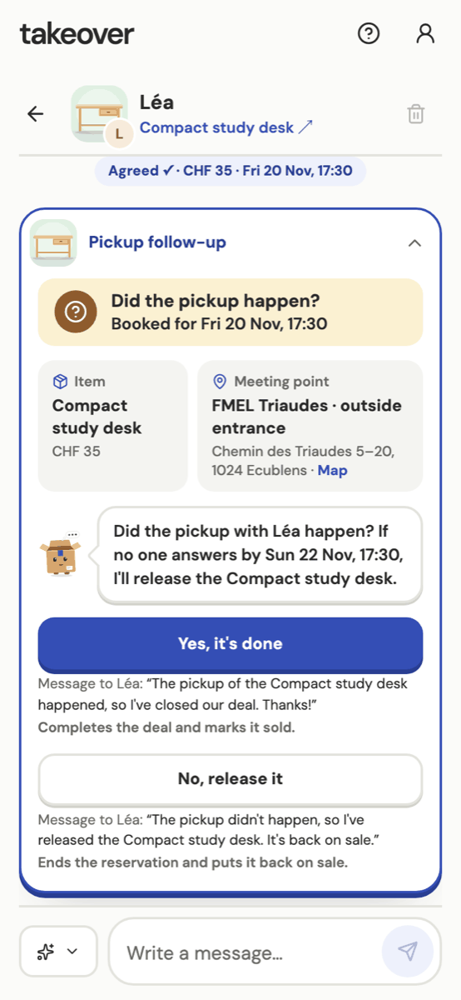

- 24 hours after the pickup time both students see "Did the pickup happen?" with Yes, it's done and No, release it.
- Without an answer, the reservation is released 24 hours later and the listing goes back on sale.

## Selling

### Sell from a photo

Pako drafts the listing from the student's photos.

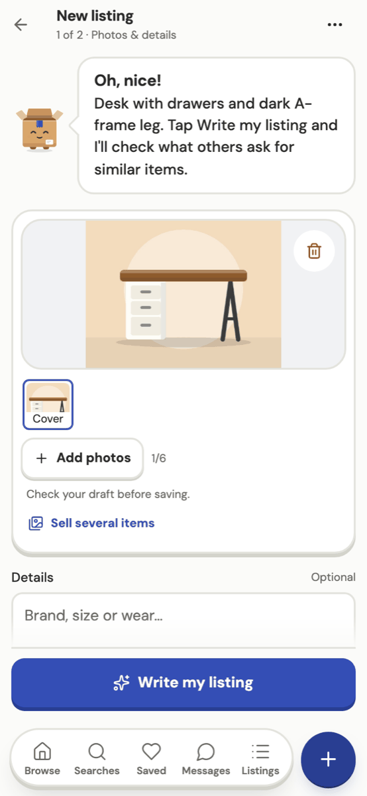

- Up to 6 photos. Pako names the item, asks one short question at a time with tap answers, and writes the description.
- The student checks the draft and saves it. Demo: Save on this device. Account mode: Publish listing.

### Price card

A suggested price with its sources, adjusted with a slider.

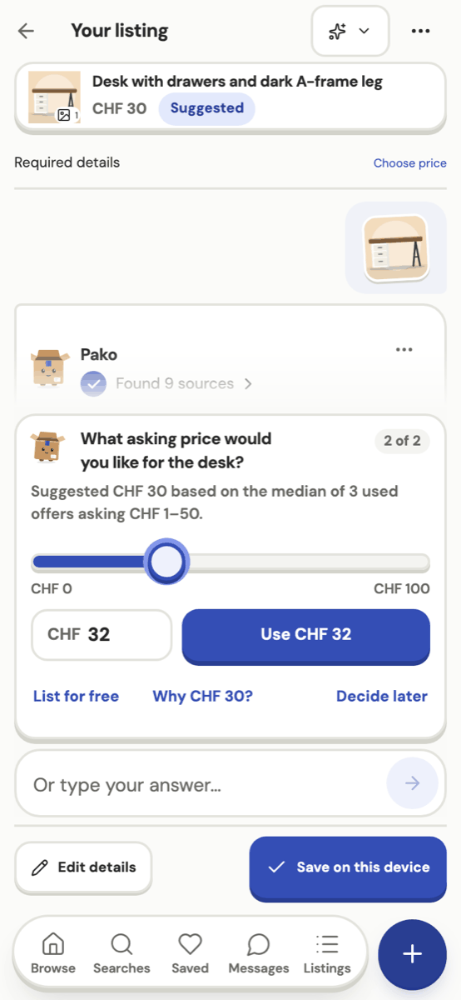

- The suggestion is based on comparable used offers; Why CHF … lists the offers it used.
- The slider and the exact field stay in sync. List for free and Decide later are always available.

### Selling several items

One upload for several items.

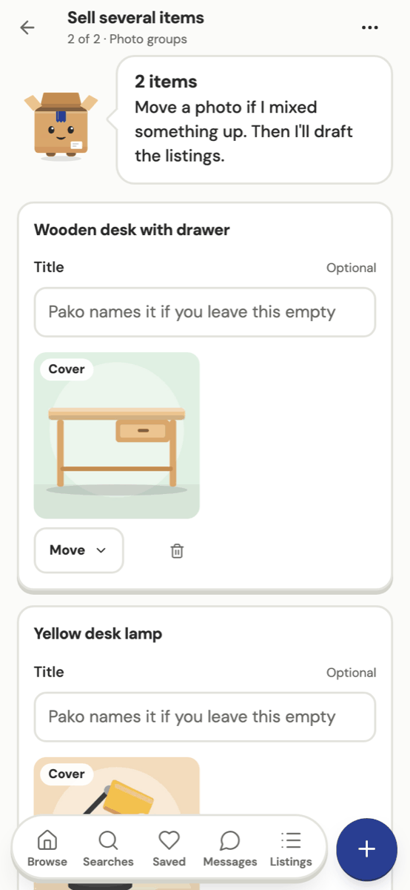

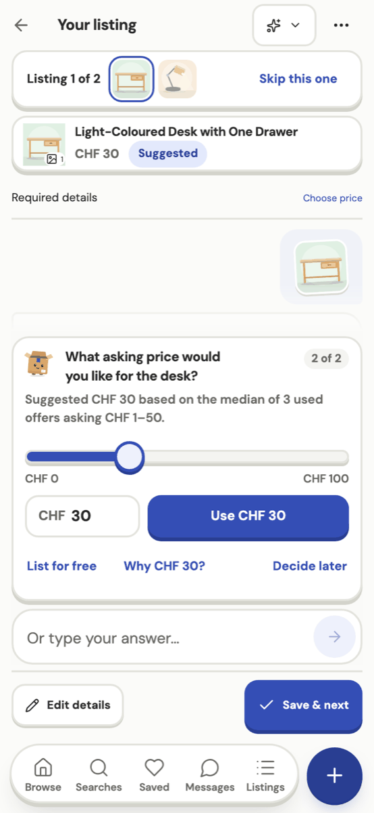

- Pako groups the photos by item; the student can move a photo to another item before drafting.
- The listings are then drafted one after the other (Save & next, Skip this one).

## Staying organised

### Saved items

Saved listings with their current state.

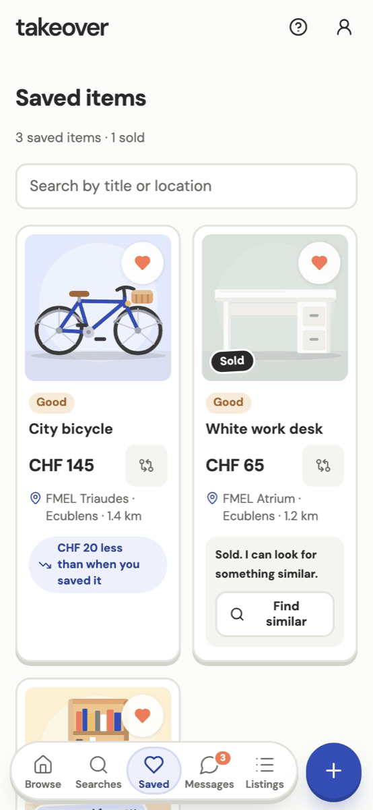

- A price drop shows how much less the item costs than when it was saved.
- A sold item shows a Sold sticker and Find similar; an item reserved for the student shows Reserved for you.

## Trust and administration

### University sign-up

Account mode is limited to university addresses.

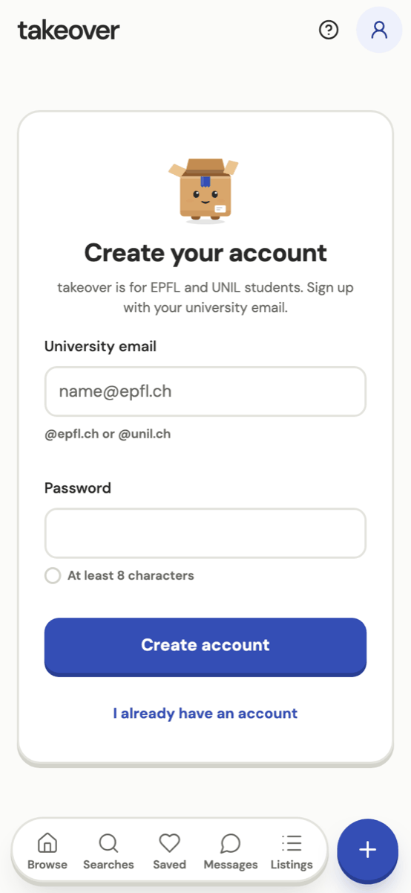

- Only @epfl.ch and @unil.ch addresses can register; the database enforces the same rule. The account is confirmed by email.
- Pako's requests are limited per UTC day: 50 per student and 500 across the app; reading replies has its own limit of 150 per student and 1,500 across the app.

### Admin area

Overview, catalogue and moderation for administrators.

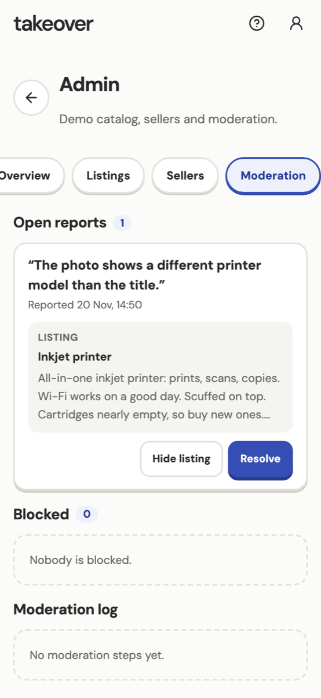

- Overview counts, listing and seller editing, reports, hiding listings and blocking students. Each moderation step needs a reason and is logged.
- Demo: opened from Settings with developer mode on, which also adds a seller-role preview in Messages and a demo clock for pickup states. Account mode: only accounts listed in `public.admins`.
