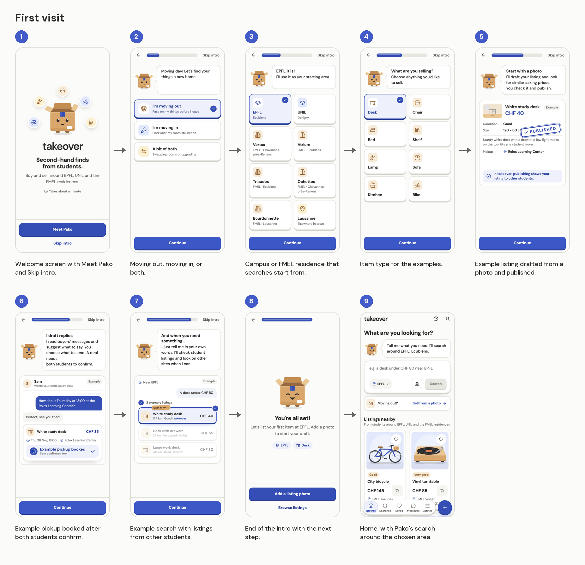
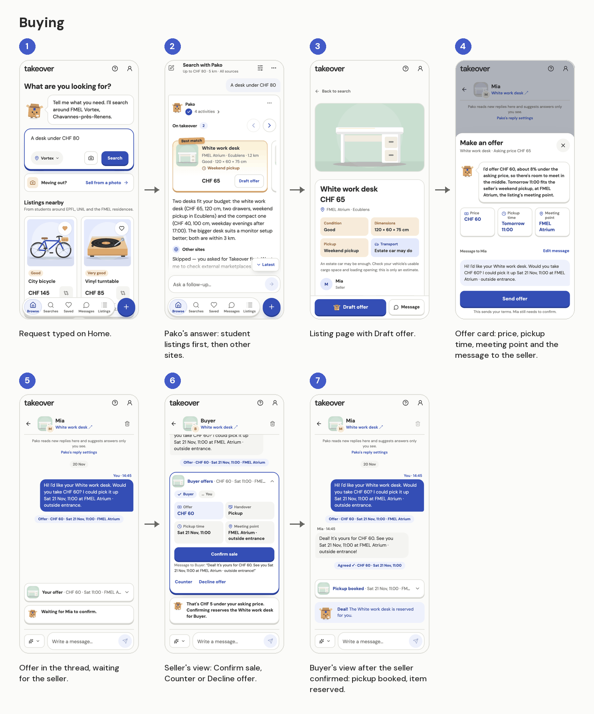
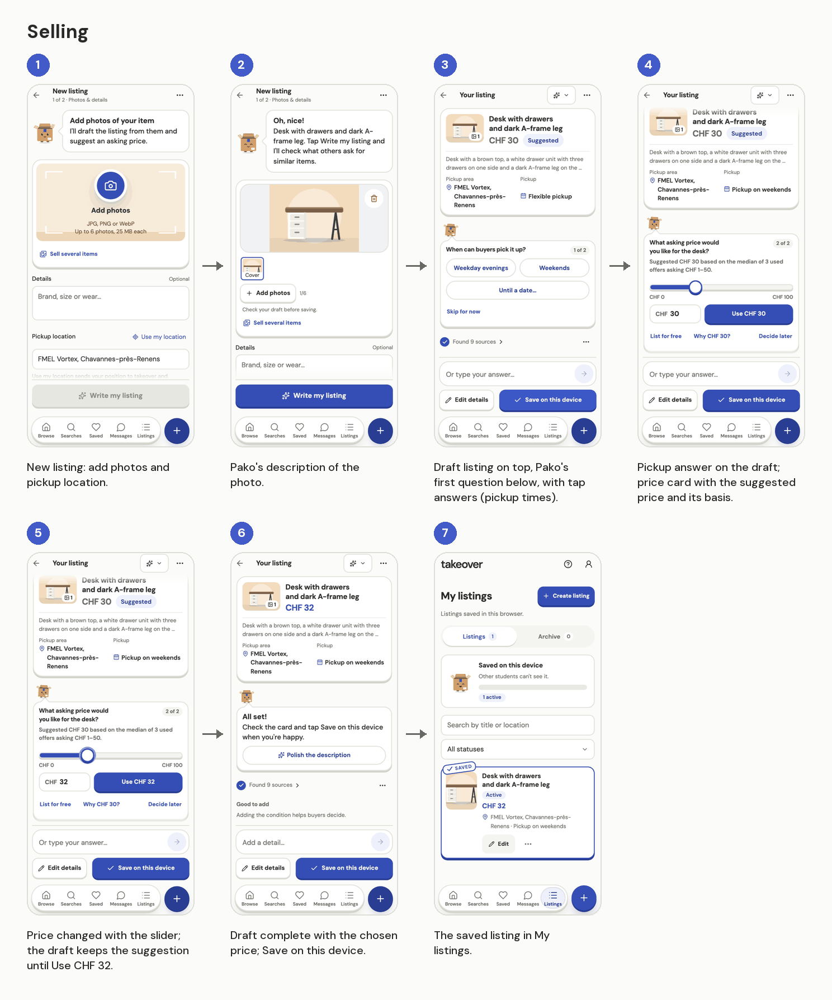
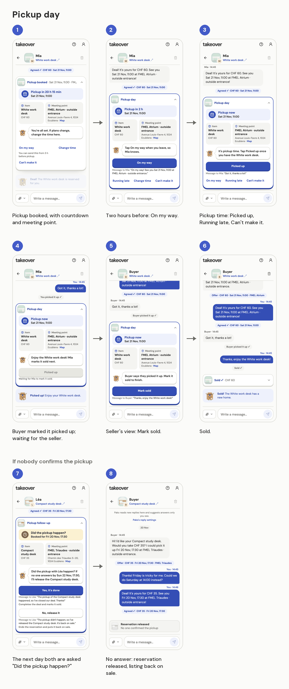
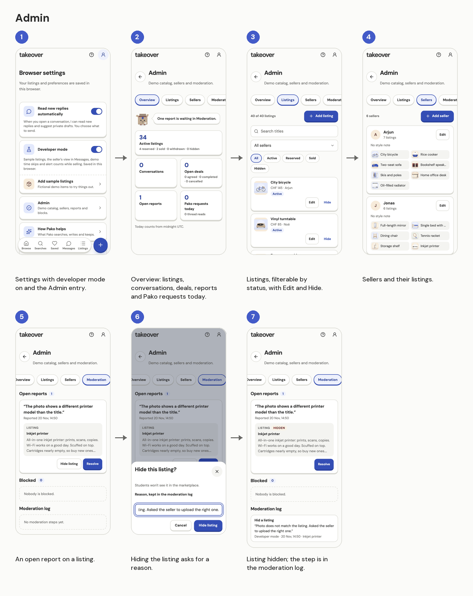
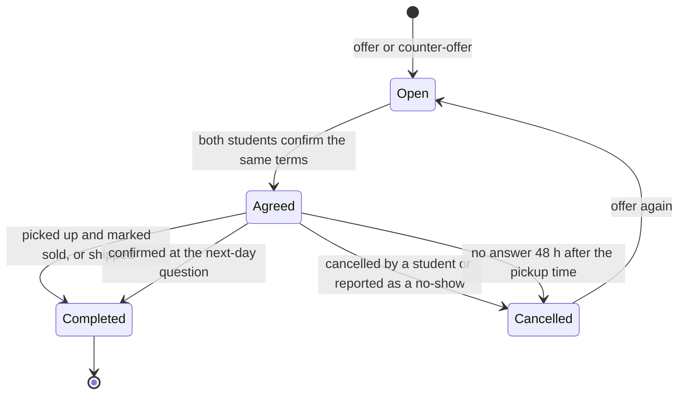

# Workflows

The main paths through takeover as step sequences. Each map shows the screens in order; the list below it links to the single screenshots. What each feature does is in [FEATURES.md](FEATURES.md).

Screenshots are from the local demo with fictional students and listings, at phone size (390 × 844). In the selling screenshots, the project's drawn illustrations stand in for item photos. The other student's side and later points in time were reached with developer mode (seller view and demo clock); those controls are hidden in the images.

## 1. First visit

A first-time visitor gets a short intro with Pako. Three answers (why they are here, their area, what they want to sell or find) personalise three example scenes: a listing drafted from a photo, a deal both students confirm, and a search. The intro can be skipped at any step and reopened with How it works in the header.

1. [Welcome screen with Meet Pako and Skip intro.](screenshots/flow-first-visit-01-welcome.png)
2. [Moving out, moving in, or both.](screenshots/flow-first-visit-02-why-here.png)
3. [Campus or FMEL residence that searches start from.](screenshots/flow-first-visit-03-area.png)
4. [Item type for the examples.](screenshots/flow-first-visit-04-what-to-sell.png)
5. [Example listing drafted from a photo and published.](screenshots/flow-first-visit-05-example-listing.png)
6. [Example pickup booked after both students confirm.](screenshots/flow-first-visit-06-example-deal.png)
7. [Example search with listings from other students.](screenshots/flow-first-visit-07-example-search.png)
8. [End of the intro with the next step.](screenshots/flow-first-visit-08-all-set.png)
9. [Home, with Pako's search around the chosen area.](screenshots/flow-first-visit-09-home.png)

## 2. Buying

The student describes what they need. Pako lists matching student listings first and web results after them. From a listing, one tap opens an offer card with Pako's proposed price, pickup time and meeting point. The buyer sends it, the seller confirms, and the listing is reserved for the buyer.

1. [Request typed on Home.](screenshots/flow-buying-01-search.png)
2. [Pako's answer: student listings first, then other sites.](screenshots/flow-buying-02-results.png)
3. [Listing page with Draft offer.](screenshots/flow-buying-03-listing.png)
4. [Offer card: price, pickup time, meeting point and the message to the seller.](screenshots/flow-buying-04-offer-proposal.png)
5. [Offer in the thread, waiting for the seller.](screenshots/flow-buying-05-offer-sent.png)
6. [Seller's view: Confirm sale, Counter or Decline offer.](screenshots/flow-buying-06-seller-confirms.png)
7. [Buyer's view after the seller confirmed: pickup booked, item reserved.](screenshots/flow-buying-07-agreed.png)

## 3. Selling

The student adds a photo. Pako describes the item and drafts the listing. Below the draft he asks one question at a time and suggests a price based on comparable used offers; each answer shows on the draft. The student sets the price with the slider or the field and saves the listing. Nothing is published without the student's tap.

1. [New listing: add photos and pickup location.](screenshots/flow-selling-01-start.png)
2. [Pako's description of the photo.](screenshots/flow-selling-02-photo-read.png)
3. [Draft listing on top, Pako's first question below, with tap answers (pickup times).](screenshots/flow-selling-03-question.png)
4. [Pickup answer on the draft; price card with the suggested price and its basis.](screenshots/flow-selling-04-price-card.png)
5. [Price changed with the slider; the draft keeps the suggestion until Use CHF 32.](screenshots/flow-selling-05-slider.png)
6. [Draft complete with the chosen price; Save on this device.](screenshots/flow-selling-06-ready.png)
7. [The saved listing in My listings.](screenshots/flow-selling-07-my-listings.png)

## 4. Pickup day

After a deal is agreed, the pickup card shows what each student can do at that moment. The buyer taps Picked up, the seller taps Mark sold. If neither confirms the pickup, both are asked 24 hours later whether it happened. Without an answer, the reservation is released after another 24 hours.

1. [Pickup booked, with countdown and meeting point.](screenshots/flow-pickup-01-booked.png)
2. [Two hours before: On my way.](screenshots/flow-pickup-02-countdown.png)
3. [Pickup time: Picked up, Running late, Can't make it.](screenshots/flow-pickup-03-pickup-time.png)
4. [Buyer marked it picked up; waiting for the seller.](screenshots/flow-pickup-04-picked-up.png)
5. [Seller's view: Mark sold.](screenshots/flow-pickup-05-mark-sold.png)
6. [Sold.](screenshots/flow-pickup-06-sold.png)

**If nobody confirms the pickup**

7. [The next day both are asked "Did the pickup happen?"](screenshots/flow-pickup-07-follow-up-24h.png)
8. [No answer: reservation released, listing back on sale.](screenshots/flow-pickup-08-released-48h.png)

## 5. Admin

In the local demo, the admin area opens from Settings once developer mode is on. In account mode it is limited to accounts listed in `public.admins`. Moderation actions need a reason and are logged.

1. [Settings with developer mode on and the Admin entry.](screenshots/flow-admin-01-developer-mode.png)
2. [Overview: listings, conversations, deals, reports and Pako requests today.](screenshots/flow-admin-02-overview.png)
3. [Listings, filterable by status, with Edit and Hide.](screenshots/flow-admin-03-listings.png)
4. [Sellers and their listings.](screenshots/flow-admin-04-sellers.png)
5. [An open report on a listing.](screenshots/flow-admin-05-report.png)
6. [Hiding the listing asks for a reason.](screenshots/flow-admin-06-hide-reason.png)
7. [Listing hidden; the step is in the moderation log.](screenshots/flow-admin-07-moderation-log.png)

## Deal states

A deal moves through four states. The listing follows it: reserved while a deal is agreed, sold when it completes, back on sale when it is cancelled.

A pickup the buyer has marked as picked up is not released automatically; it stays reserved until the seller marks it sold.
